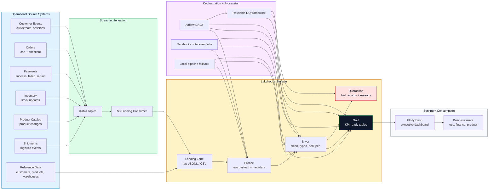
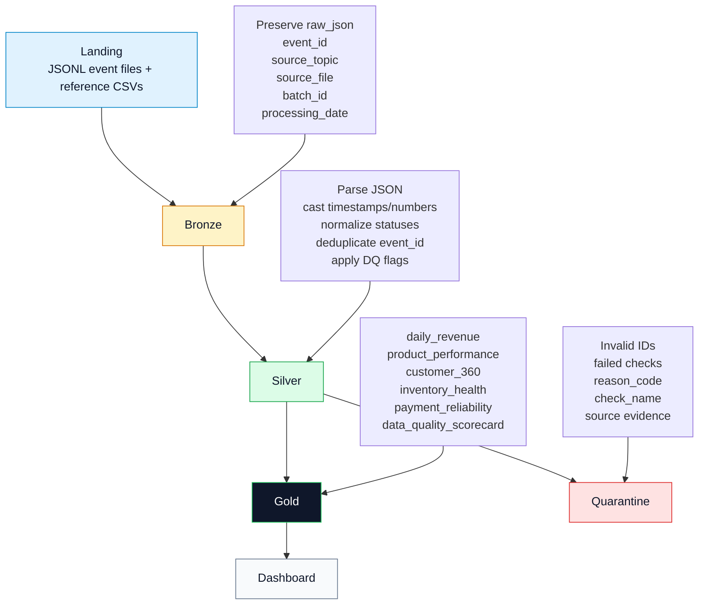
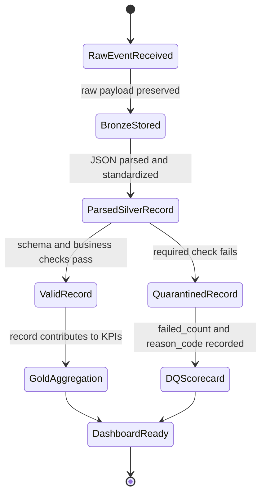
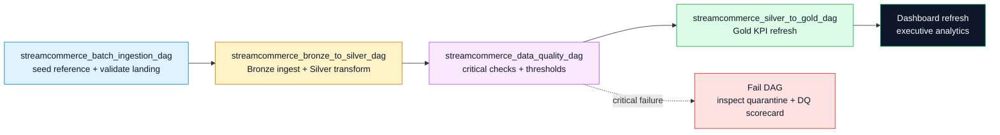
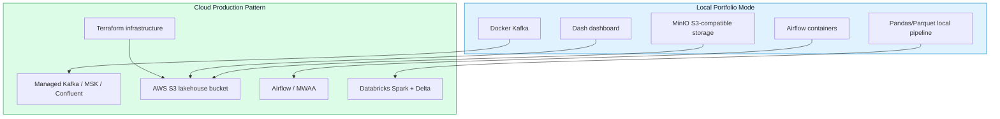

# StreamCommerce Lakehouse 360

<!-- de-book-banner -->
> ### Free book: *Data Engineering: From Zero to Production & Interview Ready*
>
> 244 pages, by the author of this repo. One order followed through a fictional
> Indian e-commerce company, with each tool arriving at the moment the story needs
> it. Every figure in it was measured rather than asserted, and the code behind
> each one is in the [Field Kit](https://github.com/analyticsdurgesh/data-engineering-book-field-kit).
>
> **[Read it free, no card &rarr;](https://www.prepnplaced.com/data-engineering-book?utm_source=github&utm_medium=repo&utm_campaign=de_book)**
<!-- /de-book-banner -->


Production-style e-commerce lakehouse platform that simulates real-time operational events, lands them in object storage, promotes data through Bronze, Silver, and Gold layers, applies reusable data quality checks, quarantines bad records, orchestrates the lifecycle with Airflow, and serves executive analytics through a Plotly Dash dashboard.

This is a public portfolio project designed to demonstrate how a modern Data Engineering platform is designed end to end: ingestion, lake storage, medallion modeling, orchestration, quality, observability, infrastructure, dashboarding, and production migration thinking.

## Executive Summary

StreamCommerce Lakehouse 360 models the analytics platform of a fictional e-commerce company. It receives events from six operational domains, writes immutable landing files, creates auditable Bronze records, produces trustworthy Silver tables, builds business-ready Gold KPI tables, and exposes insights to analytics users.

**Resume pitch:** Built a production-style real-time e-commerce lakehouse using Kafka, AWS S3/MinIO, Airflow, Databricks, Delta Lake-style Medallion layers, reusable data quality checks, quarantine handling, Terraform infrastructure, and a Plotly Dash executive dashboard.

## What This Project Proves

- Real-time event simulation across orders, payments, inventory, shipments, products, and customer behavior
- Kafka topic design for multi-domain e-commerce event streams
- S3/MinIO object-storage landing zone with replayable JSONL partitions
- Bronze ingestion with raw payload preservation and ingestion metadata
- Silver transformation with parsing, standardization, deduplication, validation, and quarantine routing
- Gold aggregate tables for revenue, customer 360, product performance, inventory health, payment reliability, and DQ scorecards
- Airflow DAG orchestration across ingestion, transformation, quality, and serving layers
- Databricks notebook and job structure for cloud execution
- Local Pandas fallback for accessible portfolio demonstration
- Terraform and AWS S3 infrastructure templates
- Plotly Dash dashboard for executive and operational monitoring
- Unit, integration, and data quality tests

## End-to-End Architecture



## Medallion Data Flow



## Data Quality And Quarantine Loop



## Airflow Orchestration



## Local To Cloud Deployment Model



## Source Event Domains

| Domain | Kafka Topic | Example Business Meaning |
| --- | --- | --- |
| Customer behavior | `customer_events` | Sessions, product views, cart events, funnel activity |
| Orders | `orders` | Checkout events, order amount, product quantity |
| Payments | `payments` | Payment success, failure, pending, refunds |
| Inventory | `inventory_updates` | Stock movement, stockout risk, warehouse state |
| Product catalog | `product_catalog_updates` | Product/category/price/catalog changes |
| Shipments | `shipment_events` | Fulfillment and delivery lifecycle |

The simulator intentionally creates production-like issues: duplicates, late events, null IDs, invalid products, negative prices, invalid payment statuses, missing timestamps, malformed JSON, schema drift, and out-of-order events.

## Lakehouse Storage Layout

Local mode writes to `data/`. Cloud mode maps the same layout to `s3://streamcommerce-lakehouse/`.

```text
landing/{customer_events,orders,payments,inventory_updates,product_catalog_updates,shipment_events}
bronze/{source_topic}/processing_date=YYYY-MM-DD
silver/{source_topic}
gold/{daily_revenue,product_performance,customer_360,inventory_health,payment_reliability,data_quality_scorecard}
quarantine/{invalid_records,schema_violations,dq_failures}
```

## Gold KPI Tables

| Gold Table | Purpose |
| --- | --- |
| `daily_revenue` | Revenue, order count, average order value by event date |
| `product_performance` | Units sold, revenue, and order volume by product/category |
| `customer_360` | Lifetime value, orders, sessions, and repeat purchase flag |
| `inventory_health` | Stock events, stockout warnings, and stockout risk |
| `payment_reliability` | Payment volume, failed payments, and failure rate |
| `data_quality_scorecard` | DQ pass rates, failed counts, and quality status by check |

## Tech Stack

| Layer | Tools |
| --- | --- |
| Event streaming | Kafka, custom Python event producers |
| Landing storage | MinIO locally, AWS S3 production pattern |
| Orchestration | Apache Airflow DAGs |
| Processing | Databricks notebooks/jobs, PySpark/Delta design, Pandas local fallback |
| Lakehouse modeling | Bronze, Silver, Gold medallion architecture |
| Data quality | Reusable Python DQ runner, quarantine tables, scorecards |
| Dashboard | Plotly Dash, Dash Bootstrap Components |
| Infrastructure | Docker Compose, Terraform, AWS S3 |
| Testing | pytest, unit tests, integration tests, DQ tests |

## Repository Structure

```text
.
├── airflow/dags/                 # Orchestration DAGs
├── configs/                      # Local and cloud config templates
├── dashboard/                    # Plotly Dash executive dashboard
├── data_contracts/               # JSON schemas for source events
├── databricks/
│   ├── notebooks/                # Cloud notebook entrypoints
│   ├── jobs/                     # Databricks job config
│   └── src/                      # Bronze/Silver/Gold/DQ pipeline modules
├── docs/                         # Architecture, runbooks, interview guide
├── infra/terraform/              # AWS S3 infrastructure templates
├── kafka/
│   ├── producers/                # Event simulators
│   └── consumers/                # Landing consumer
├── scripts/                      # Local setup and validation commands
└── tests/                        # Unit, integration, and quality tests
```

## Local Setup

```bash
python -m venv .venv
source .venv/bin/activate
pip install -r requirements.txt
cp .env.example .env
make up
make init
```

Open:

- Airflow: `http://localhost:8080`
- MinIO console: `http://localhost:9001`
- Dashboard: `http://localhost:8050`

Local demo credentials are defined only for Docker development. Replace them before any shared or production deployment.

## Run Locally

Seed reference data:

```bash
python scripts/seed_reference_data.py
```

Produce events:

```bash
python -m kafka.producers.event_simulator --source customer_events --event-rate 5 --duration 60 --bad-data-percentage 8
python -m kafka.producers.event_simulator --source orders --event-rate 3 --duration 60 --bad-data-percentage 10
```

Consume Kafka into landing files:

```bash
python -m kafka.consumers.s3_landing_consumer --landing-root data/landing
```

Run the local medallion pipeline:

```bash
make run-pipeline
```

Start the dashboard:

```bash
make dashboard
```

Run validation:

```bash
make validate
```

Run tests:

```bash
make test
```

## Cloud Pattern

Provision the S3 lakehouse bucket:

```bash
cd infra/terraform
terraform init
terraform apply -var="bucket_name=streamcommerce-lakehouse" -var="aws_region=us-east-1"
```

Configure Databricks:

```bash
export ENVIRONMENT=prod
export DATABRICKS_HOST="https://..."
export DATABRICKS_TOKEN="..."
export DATABRICKS_CLUSTER_ID="..."
```

Import `databricks/notebooks/*.py` into Databricks Repos, create a job from `databricks/jobs/streamcommerce_lakehouse_job.json`, and point widgets at:

```text
s3://streamcommerce-lakehouse/{landing,bronze,silver,gold,quarantine}
```

## Data Quality Framework

The reusable DQ runner produces:

- pass/fail status
- failed record counts
- total record counts
- pass percentages
- `check_name`
- `reason_code`
- quarantine output for failed records

Checks include schema presence, completeness, valid payment statuses, non-negative prices, positive quantities, uniqueness, and business rules for successful payments.

## Portfolio Talking Points

- Designed a replayable lakehouse with raw preservation, medallion promotion, and quarantine evidence.
- Simulated realistic e-commerce operational streams instead of using a static toy CSV.
- Built local and cloud execution paths so the project is both runnable and production-oriented.
- Added data contracts, DQ scorecards, Airflow DAGs, Databricks jobs, Terraform, and dashboarding to show full platform thinking.
- Separated invalid data from trusted Silver/Gold outputs while keeping failed records available for debugging.

## Known Limitations

This is a portfolio-grade implementation, not a managed production deployment. Local mode uses Pandas and Parquet/CSV fallbacks for accessibility. Production streaming checkpointing, IAM least-privilege roles, Delta optimization schedules, lineage tooling, and observability integrations are documented as future enhancements.

## Future Enhancements

- Kafka Schema Registry or Confluent-compatible schema governance
- Great Expectations, Soda, or OpenMetadata integration
- Databricks Asset Bundles
- CDC sources for order and payment systems
- Delta Live Tables or structured streaming checkpoints
- dbt semantic models over Gold tables
- Feature store outputs for churn and recommendation models
- Slack/PagerDuty alerting for DQ and freshness failures

## Documentation

- [Architecture](docs/architecture.md)
- [Data Flow](docs/data_flow.md)
- [Medallion Design](docs/medallion_design.md)
- [Data Quality Framework](docs/data_quality_framework.md)
- [End-to-End Runbook](docs/end_to_end_runbook.md)
- [Dashboard Guide](docs/dashboard_guide.md)
- [Interview Explanation](docs/interview_explanation.md)
- [Resume Bullets](docs/resume_bullets.md)

## Author

Built by [Durgesh Yadav](https://github.com/analyticsdurgesh) as a senior data engineering portfolio project.
